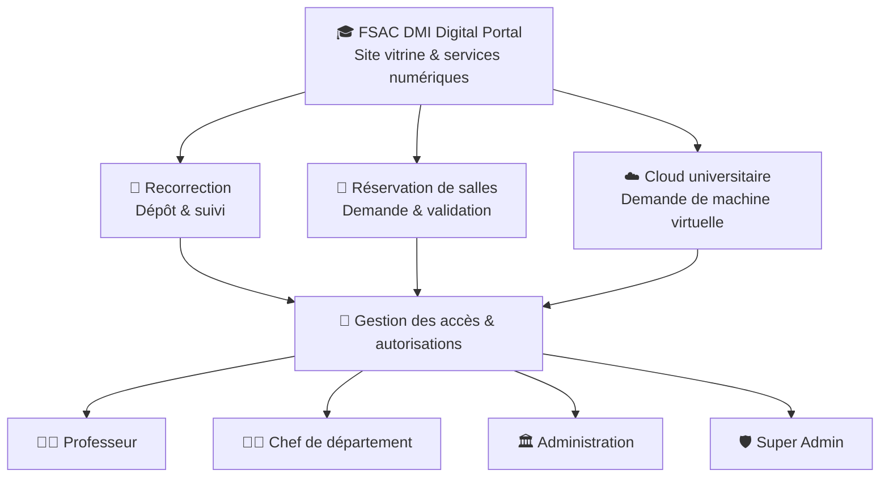
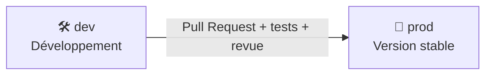

<div align="center">

# 🎓 FSAC DMI Digital Portal

### Département de Mathématiques & Informatique — Faculté des Sciences Aïn Chock
**Université Hassan II de Casablanca**

**Un portail universitaire pour connecter étudiants, enseignants et administration.**

📝 Recorrection · 🏫 Réservation de salles · ☁️ Cloud universitaire · 🔐 Accès par rôle · ⚡ Digitalisation

**Symfony 7.4** · **PHP** · **Twig** · **Doctrine ORM** · **PostgreSQL** · **HTML/CSS** · **JavaScript minimal**

</div>

---

## 📖 Présentation

**FSAC DMI Digital** est un projet de plateforme web dédié au **Département de Mathématiques et Informatique (DMI)** de la **Faculté des Sciences Aïn Chock (FSAC)**, Université Hassan II de Casablanca.

Son objectif est de centraliser les informations du département et de simplifier les démarches grâce à des services numériques accessibles, traçables et sécurisés.

> **État du projet : en développement.** Le socle Symfony 7.4 est créé ; les modules décrits ci-dessous correspondent au périmètre fonctionnel visé. Leur disponibilité dépend de leur implémentation et de leurs tests.

## 🧭 Architecture fonctionnelle



### Les trois services principaux

| 📝 Recorrection | 🏫 Réservation de salles | ☁️ Cloud universitaire |
|:---|:---|:---|
| Dépôt et suivi des demandes | Demande de salle ou d'amphithéâtre | Catalogue de configurations VM |
| Affectation et traitement par l'enseignant | Vérification des disponibilités | Sélection CPU, RAM, stockage et OS |
| Historique, validation et notification | Validation par une personne autorisée | Validation, quotas et durée de vie |
| Confidentialité des notes | Calendrier et prévention des conflits | Provisionnement après autorisation |

## 📝 Module de recorrection

**Objectif :** faciliter le dépôt et le suivi des demandes de recorrection sans exposer publiquement les notes.

**Parcours cible :** étudiant → demande → administration / chef de département → professeur concerné → clôture et notification.

| Couleur | Statut visible au public | Signification |
|:---:|---|---|
| 🔴 | Aucune demande | Aucune demande trouvée pour le numéro de suivi |
| 🟡 | En attente | Demande enregistrée, en attente de validation ou d'affectation |
| 🔵 | En cours | Demande prise en charge par les services autorisés |
| 🟢 | Traitée | Traitement terminé ; résultat communiqué par le canal autorisé |

> Les **notes initiales, notes finales, changements éventuels et motifs détaillés** ne sont jamais affichés dans la consultation publique. L'accès est réservé aux personnels habilités, avec contrôle serveur et journalisation.

## 🏫 Module de réservation de salles

Le professeur soumet une demande en précisant une salle, un créneau et un motif. Le chef de département ou l'administration valide ou refuse selon les droits attribués.

- 📅 Calendrier des disponibilités et détection des conflits.
- 🏛️ Gestion des salles, capacités, types et équipements.
- ✅ Circuit de validation et historique des décisions.
- 🔔 Notification du demandeur après décision.

## ☁️ Module Cloud universitaire

Le module Cloud permet de **demander** une machine virtuelle pour les enseignements, TP, projets et expérimentations autorisés.

- 🖥️ Modèles de VM prédéfinis (système, vCPU, RAM, stockage).
- 🧾 Justification pédagogique ou scientifique et durée souhaitée.
- 🔐 Approbation, quotas, suivi des demandes et audit.
- ⚙️ Intégration possible à une infrastructure autorisée (par exemple Proxmox ou OpenStack).

> **Important :** déposer une demande ne crée pas automatiquement de VM. Le provisionnement nécessite une infrastructure réelle, des accès sécurisés et une validation administrative.

## 👥 Espaces et rôles

| Acteur | Principales possibilités prévues |
|---|---|
| **Étudiant (consultation publique)** | Consulter le site et suivre un dossier via une référence de suivi ; déposer une demande selon les règles retenues |
| **👨‍🏫 Professeur** | Traiter les recorrections qui lui sont affectées, demander une salle et une VM |
| **🧑‍💼 Chef de département** | Valider les demandes relevant de son département et consulter les tableaux de suivi |
| **🏛️ Administration** | Gérer les affectations, salles, demandes, notifications et contenus autorisés |
| **🛡️ Super Admin** | Administrer les comptes, rôles, paramètres et contenus du portail |

Les autorisations devront être appliquées **côté serveur** (Symfony Security et voters), et non uniquement dans l'interface.

## ✨ Site vitrine et expérience utilisateur

- 🎨 Interface responsive, thème clair/sombre et fonds SVG FSAC.
- 🎓 Hero animé, avatar d'accueil, chargement soigné et transition fluide.
- 📰 Actualités, formations, laboratoires, équipe pédagogique et messages des responsables.
- 🪄 Cartes translucides et animations CSS légères, avec JavaScript réduit au strict nécessaire.
- ♿ Navigation clavier, contrastes accessibles et prise en charge de `prefers-reduced-motion`.

## 🧰 Stack technique visée

| Couche | Technologies |
|---|---|
| **Backend** | PHP, Symfony 7.4, Symfony Security, Messenger |
| **Frontend** | Twig, HTML5, CSS3, JavaScript minimal, AssetMapper |
| **Données** | Doctrine ORM, PostgreSQL (SQLite possible en développement) |
| **API** | API REST pour les intégrations nécessaires |
| **Notifications** | E-mail ; Mercure/WebSocket si besoin de temps réel |
| **Qualité & déploiement** | PHPUnit, GitHub, Docker (optionnel) |
| **Infrastructure Cloud** | Intégration Proxmox / OpenStack, sous réserve d'autorisation |

## 📁 Organisation cible du projet

```text
my_dmi_management/
├── assets/                    # CSS, JS et ressources frontend
├── bin/                       # Console Symfony
├── config/                    # Routes, sécurité et configuration
├── public/                    # Point d'entrée et médias publics
├── src/
│   ├── Controller/            # Contrôleurs du portail et des espaces
│   ├── Entity/                # User, CorrectionRequest, Room, Reservation, VMRequest...
│   ├── Form/                  # Formulaires métier
│   ├── Repository/            # Requêtes et accès aux données
│   ├── Security/              # Authentification et autorisations
│   └── Service/               # Logique métier et intégrations
├── templates/                 # Twig : accueil, recorrection, salles, cloud, admin
├── migrations/                # Migrations Doctrine (après configuration)
├── tests/                     # Tests unitaires et fonctionnels
├── translations/              # Traductions
├── .env                       # Valeurs non sensibles
└── composer.json              # Dépendances PHP
```

> Cette arborescence est une **structure cible** : certains dossiers et fichiers seront créés à mesure du développement.

## 🚀 Installation locale

### Prérequis

- PHP compatible avec Symfony 7.4 et extensions nécessaires.
- Composer à jour et Symfony CLI (recommandé).
- Git ; PostgreSQL si cette base est retenue.

### Récupérer le dépôt

```bash
git clone https://github.com/abdelhakmireda/fsac-dmi-digital-portal.git
cd fsac-dmi-digital-portal
git switch dev
composer install
```

### Configuration

```bash
# Créer un fichier local de configuration (ne pas le versionner)
# Sous PowerShell : Copy-Item .env .env.local
# Adapter DATABASE_URL seulement après installation/configuration de Doctrine.
php bin/console about
symfony server:start
```

Une fois le modèle de données et les migrations implémentés, exécuter les commandes Doctrine adaptées pour créer le schéma en local. Ne pas lancer de migration en production sans sauvegarde ni validation.

## 🌿 Stratégie Git

| Branche | Utilisation |
|---|---|
| **`dev`** | Développement, intégration et tests des fonctionnalités |
| **`prod`** | Versions stabilisées et approuvées pour publication |



Les nouvelles fonctionnalités arrivent dans `dev` et sont intégrées dans `prod` **uniquement après validation**. Protéger `prod` dans GitHub et ne jamais publier de secrets, fichiers `.env.local`, mots de passe ou clés d'accès Cloud.

## 🗺️ Feuille de route

- [x] Initialiser le projet Symfony 7.4.
- [ ] Intégrer le site vitrine futuriste dans Twig.
- [ ] Créer les entités, migrations et comptes avec authentification.
- [ ] Implémenter le circuit de recorrection et le suivi public confidentiel.
- [ ] Implémenter les salles, disponibilités et validations.
- [ ] Implémenter les demandes de VM et les quotas.
- [ ] Ajouter notifications, journal d'audit et tests.
- [ ] Auditer la sécurité, l'accessibilité et préparer le déploiement.

## 🔒 Sécurité et données personnelles

La plateforme traite potentiellement des données étudiantes et professionnelles. Les accès doivent respecter le principe du moindre privilège, avec contrôle d'autorisation, protection CSRF, validation des données, journalisation, sauvegardes et politique de conservation. Toute connexion à Apogée ou à l'infrastructure universitaire devra être expressément autorisée.

## 👨‍💻 Projet

**FSAC DMI Digital Portal** — projet de digitalisation des services du Département de Mathématiques et Informatique, Faculté des Sciences Aïn Chock, Université Hassan II de Casablanca.

**Développement :** [abdelhakmireda](https://github.com/abdelhakmireda)  
**Repository :** [fsac-dmi-digital-portal](https://github.com/abdelhakmireda/fsac-dmi-digital-portal)

> Prototype en développement. Ce dépôt ne constitue pas, à lui seul, une annonce de mise en production officielle de l'université.
